<p align="center">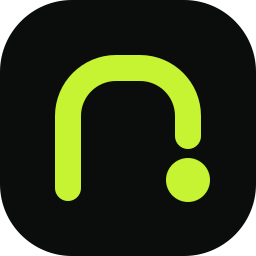</p>

# Última Milla

**El reparto del día de una distribuidora, a la vista de todos.** Última Milla es una app móvil para el último tramo de la logística: del depósito a la puerta de cada comercio.

- **El chofer** ve su ruta del día con las paradas ordenadas en el mapa, sabe a qué hora llega a cada una y confirma cada entrega con el nombre y la firma de quien recibe.
- **El cliente** (un almacén, un kiosco, un bar) sigue el camión en el mapa, sabe cuántas entregas faltan antes de la suya y recibe un aviso cuando quedan 10 minutos.

Hecha con **React Native + Expo (SDK 57) + TypeScript** y Expo Router. Anda en **Expo Go**, en Android/iOS y en la **web**.

> **Datos simulados.** "Distribuidora Bandada" es una empresa ficticia. Clientes, teléfonos, direcciones, pedidos y la posición del camión son inventados; las coordenadas caen en Paraná (Entre Ríos) solo para que el mapa muestre calles reales. No hay servidor: todo se simula en el teléfono.

| Bienvenida | Login | Ruta del chofer |
| :---: | :---: | :---: |
| 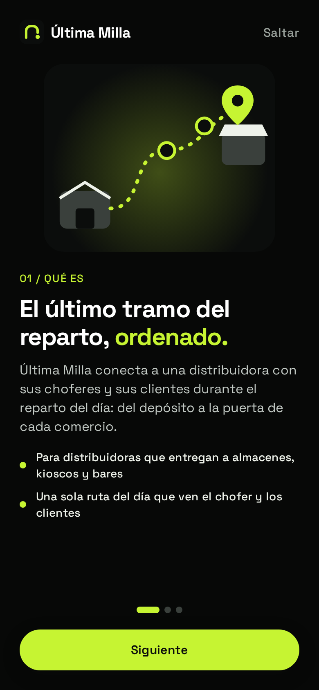 | 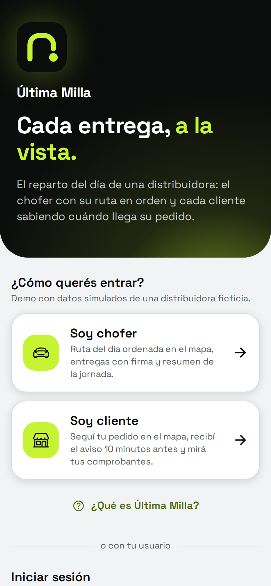 | 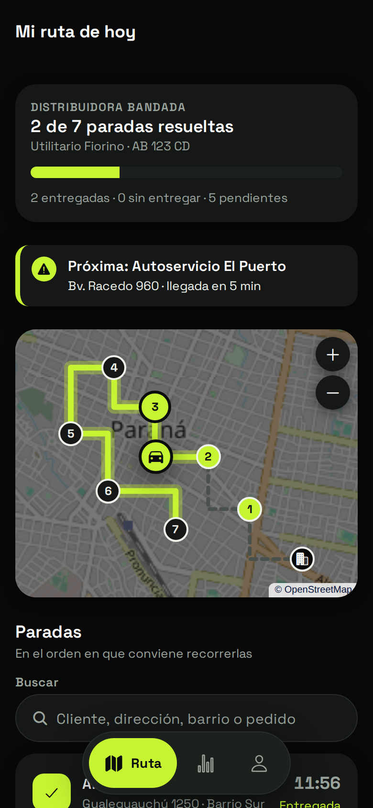 |

---

## El problema

En una distribuidora chica o mediana el reparto se coordina por WhatsApp: el chofer sale con una lista en papel, el comercio llama para preguntar "¿a qué hora llegan?" y nadie sabe si una entrega se hizo hasta que vuelve el camión. Última Milla junta esas tres cosas en una sola ruta del día que ven el chofer y los clientes.

## Probar la app

```bash
npm install
```

```bash
npx expo start
```

- **Expo Go:** escaneá el QR con la app Expo Go (Android) o con la cámara (iOS).
- **Web:** apretá `w` en la terminal, o corré `npm run web`.

La primera vez se abre la **bienvenida** (tres pasos que explican qué es y para quién). Después, en el login, elegí **Soy chofer** o **Soy cliente**, o entrá con un usuario de prueba:

| Rol | Correo | Contraseña |
| --- | --- | --- |
| Chofer | `chofer@demo.com` | `demo1234` |
| Cliente | `cliente@demo.com` | `demo1234` |

**Recorrido sugerido:** entrá como chofer, abrí la próxima parada, tocá **Entregar y firmar**, firmá y confirmá. Mirá el **Resumen**. Después cerrá sesión desde **Perfil**, entrá como cliente y fijate cómo cambió el seguimiento. En **Perfil → Reiniciar la ruta de hoy** la demo vuelve al principio.

---

## Pantallas

### Chofer

| Ruta del día | Detalle de la parada | Confirmar con firma | Resumen del día |
| :---: | :---: | :---: | :---: |
| 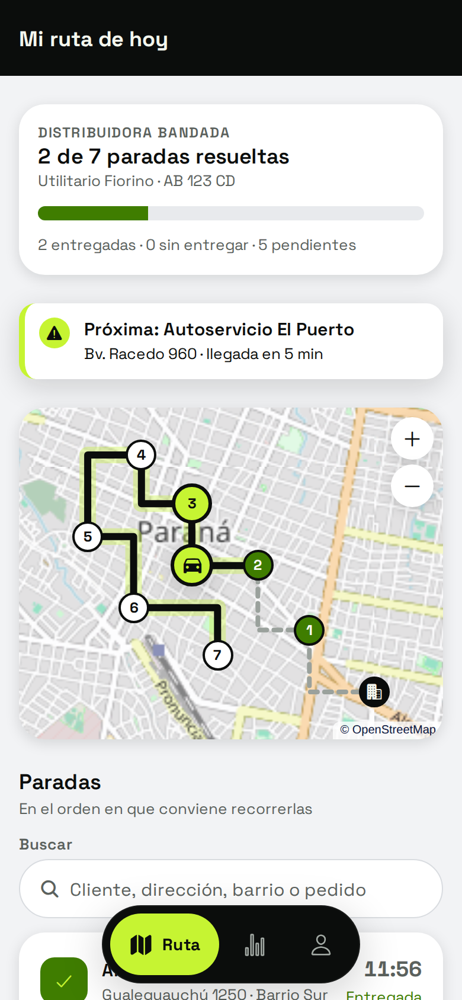 | 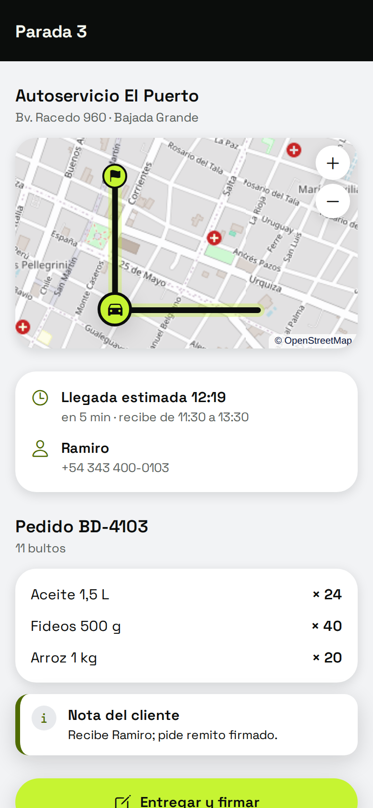 | 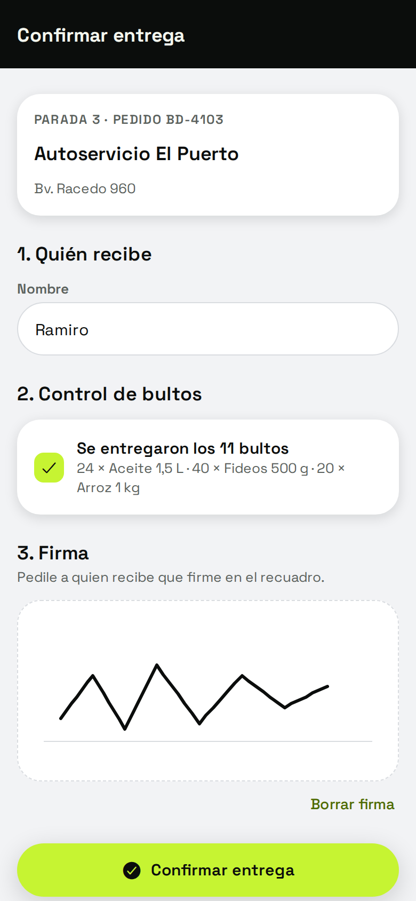 | 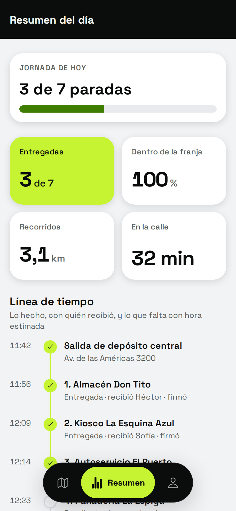 |

- **Ruta:** avance del día, la próxima entrega destacada, mapa con el depósito, las paradas numeradas, el recorrido (lo hecho punteado) y el camión; lista con la hora estimada de cada parada, que se corre sola si el camión se atrasa; búsqueda por cliente, dirección, barrio o código de pedido.
- **Parada:** quién recibe, franja horaria, bultos y productos, nota del cliente; alerta si la llegada cae fuera de la franja; **Avisar al cliente** (hoja de compartir) y **Cómo llegar**.
- **Entregar y firmar:** nombre de quien recibe, control de bultos y firma con el dedo; sin los tres no se puede confirmar. Si no se pudo entregar, se elige el motivo.
- **Resumen:** entregas, puntualidad (dentro de la franja del cliente), kilómetros, tiempo en la calle y la línea de tiempo de la jornada.

### Cliente

| Mi pedido | Historial | Comprobante | Modo oscuro |
| :---: | :---: | :---: | :---: |
| 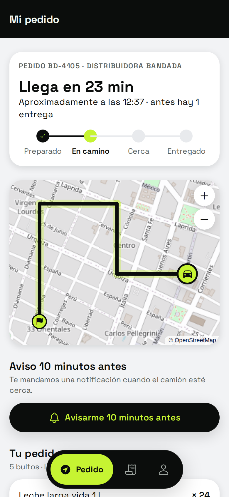 | 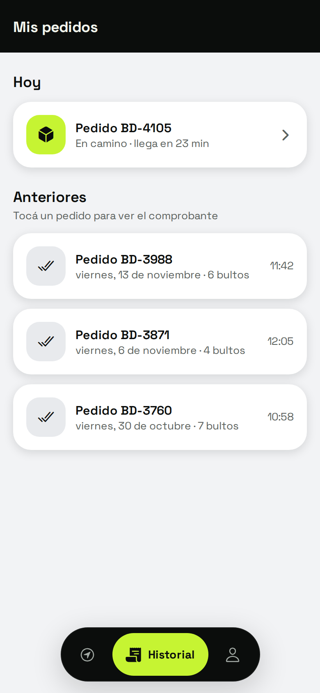 | 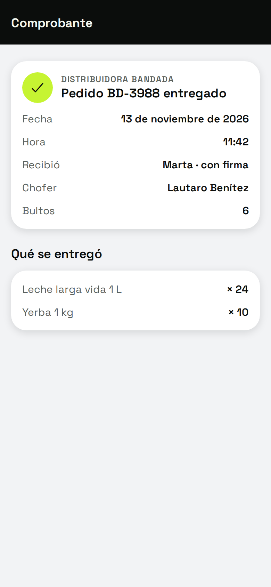 | 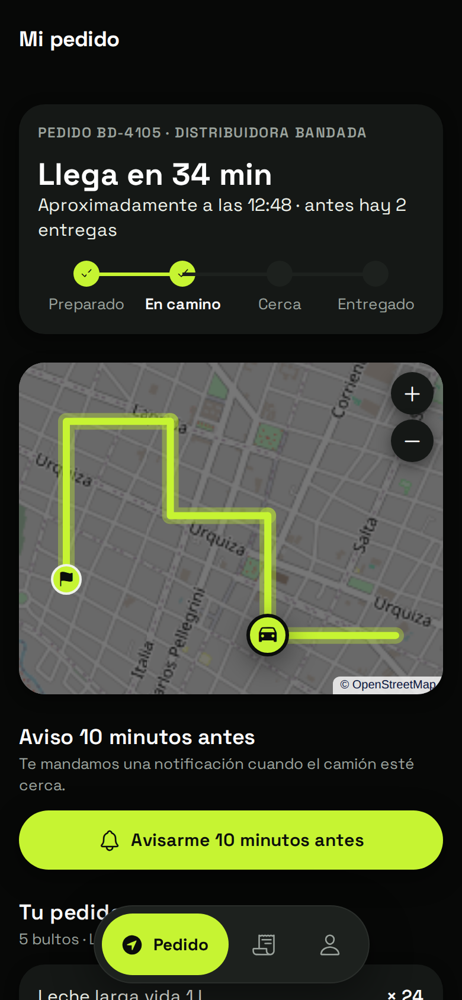 |

- **Mi pedido:** "llega en X min", etapas (preparado → en camino → cerca → entregado), mapa con el camión y el camino que falta hasta su puerta (sin mostrar a los otros clientes), **aviso 10 minutos antes** y compartir el seguimiento.
- **Historial:** el pedido de hoy y los anteriores; cada uno abre su **comprobante** (fecha, hora, quién recibió, chofer, productos).
- **Perfil** (los dos roles): datos de la cuenta, tema claro/oscuro/sistema, vibración, "Cómo funciona" y reinicio de la demo.

El aviso es una notificación local programada en el teléfono; si el camión se demora, se reprograma sola. En la web, donde no hay notificaciones programadas, aparece dentro de la pantalla.

---

## Marca

| | |
| --- | --- |
| Concepto | Un arco de ruta que termina en un punto: el último tramo hasta la puerta del cliente. |
| Paleta | Grafito `#0B0D0C` + un único acento lima neón `#C6F432`; error en coral `#FF5C39`. En claro, fondos gris frío `#F2F3F5`. |
| Tipografía | Space Grotesk. |
| Estilo | Botones píldora, tarjetas de 22 px, barra de pestañas flotante, cifras grandes y la ruta con brillo en modo oscuro. |
| Archivos | `docs/marca/logo.svg`, `logo-mono.svg` y `marca.json` (tokens). En el código: `src/tema/paleta.ts`. |

## De dónde sale

Está **basado en un trabajo grupal** de la UNER (Tecnicatura Universitaria en Desarrollo Web, materia Desarrollo para Móviles, 2026): **Paran**, una app de colectivos de Paraná que hicimos en un grupo de cinco. En ese trabajo yo fui quien más aportó (29 de 72 commits) y **hice**:

- el **sistema de diseño**: paleta clara/oscura, medidas, tipografía y los componentes base (texto, botones, tarjetas, campos, estados vacíos y de error, esqueletos de carga, diálogos, avisos);
- la **navegación** y las pantallas de **inicio**, **login**, búsqueda de líneas y paradas, y detalle de línea con su recorrido;
- los **mapas con OpenStreetMap** y el trazado del recorrido;
- el **aviso 10 minutos antes**, **compartir** y **deslizar para actualizar**;
- la configuración de **EAS** y el **README**.

**Esta versión es 100 % mía.** De Paran traje solo código que escribí yo (los componentes base, el tema, los hooks de carga/hora/vibración/preferencias y el simulador de latencia), y lo adapté a la marca nueva. Todo lo demás se escribió de cero:

| Nuevo en Última Milla | Detalle |
| --- | --- |
| Dominio de logística | Rutas, paradas ordenadas, pedidos, entregas con comprobante y motivos de no entrega (`src/tipos`, `src/datos`). |
| Motor de la ruta | Horas estimadas que se corren con los atrasos, parada actual, posición simulada del camión, aviso, resumen del día (`src/utils/ruta.ts`). |
| Mapa propio | Mosaicos de OpenStreetMap + capa SVG con zoom fraccionario. No usa SDK nativo de mapas, por eso corre en **Expo Go** y en la web (`src/componentes/MapaRuta`). |
| Dos roles con pestañas | Chofer (Ruta, Resumen, Perfil) y cliente (Pedido, Historial, Perfil) sobre el mismo estado del día (`src/hooks/useJornada.tsx`). |
| Bienvenida y firma | Tres pasos ilustrados con SVG; firma con el dedo (`src/componentes/Ilustracion`, `FirmaPad`). |
| Aviso que se reprograma | Si cambia la llegada estimada, se cancela y vuelve a programar la notificación (`src/hooks/useAvisoLlegada.ts`). |
| Identidad nueva | Nombre, logo, ícono, splash, paleta grafito + lima y Space Grotesk. |
| Tests | Jest con `jest-expo` para la lógica de ruta, resumen, mapa y sesión. |

---

## Estructura

```
src/
  app/                     Pantallas (Expo Router)
    bienvenida.tsx         Qué es, para el chofer, para el cliente
    login.tsx              Elegir rol o entrar con usuario de prueba
    chofer/(tabs)/         Ruta, Resumen, Perfil
    chofer/parada/[id]     Detalle de una entrega
    chofer/confirmar/[id]  Quién recibe, bultos y firma
    cliente/(tabs)/        Mi pedido, Historial, Perfil
    cliente/pedido/[codigo] Comprobante
  app-estilos/             Estilos de pantallas que no son componentes
  componentes/             Componentes visuales; cada uno con su archivo .estilos.ts
  datos/                   Distribuidora ficticia: usuarios, clientes, pedidos, historial
  db/                      Preferencias en kv-store (localStorage en la web)
  hooks/                   Sesión, jornada, ruta, aviso de llegada, tema, vibración
  servicios/               Capa "API" simulada, notificaciones y compartir
  tema/                    Paleta, medidas y navegación
  tipos/                   Modelo de datos
  utils/                   Lógica pura: ruta, geo, motivos, validaciones
__tests__/                 Tests de la lógica
scripts/capturas.mjs       Saca las capturas del README con Playwright
docs/                      Capturas y archivos de marca
```

## Scripts

| Comando | Qué hace |
| --- | --- |
| `npm start` | Levanta Expo (QR para Expo Go). |
| `npm run web` | Abre la app en el navegador. |
| `npm test` | Corre los tests con Jest. |
| `npm run typecheck` | Revisa los tipos con TypeScript. |
| `npm run lint` | ESLint con la config de Expo. |
| `npm run capturas` | Con la web levantada, regenera `docs/capturas/` (`BASE_URL` para otro puerto). |

## Builds con EAS

`eas.json` tiene tres perfiles: `development` (development build, APK interno), `preview` (APK para compartir) y `production`. Antes del primer build hay que vincular el proyecto con `eas init` (agrega el `projectId` a `app.json`).

```bash
npx eas-cli build -p android --profile preview
```

## Créditos

- Mapas: © colaboradores de [OpenStreetMap](https://www.openstreetmap.org/copyright). Los mosaicos se piden a `tile.openstreetmap.org`, que es para uso liviano; para producción habría que usar un proveedor de mosaicos propio o pago.
- Tipografía: Space Grotesk (Google Fonts). Íconos: Ionicons.

## Licencia

© 2026 Virginia Ponce. Todos los derechos reservados.

Este repositorio es público sólo para mostrar mi trabajo como portfolio y para evaluación técnica. No se otorga permiso para copiar, modificar, distribuir ni usar este código, total o parcialmente, sin mi autorización por escrito.
