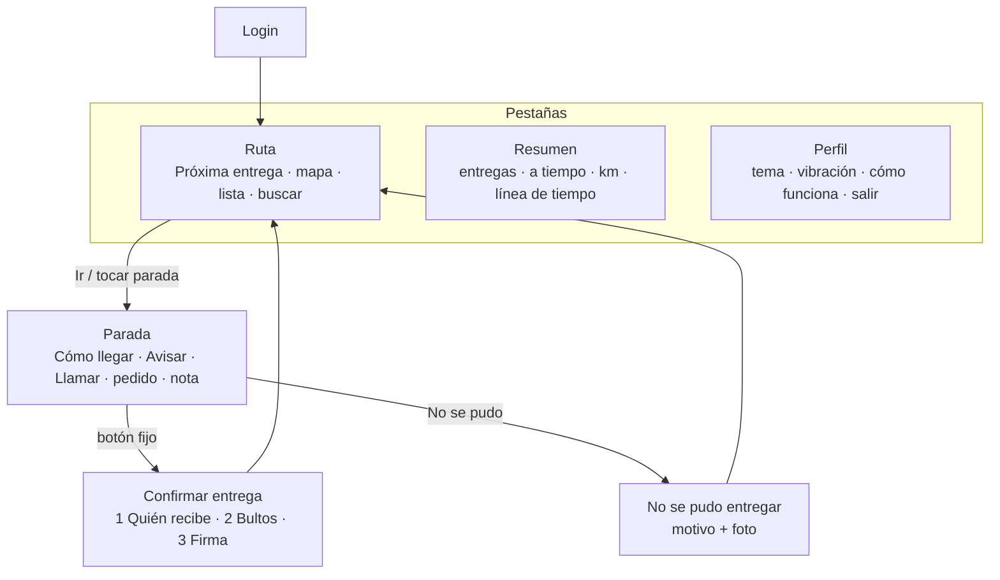
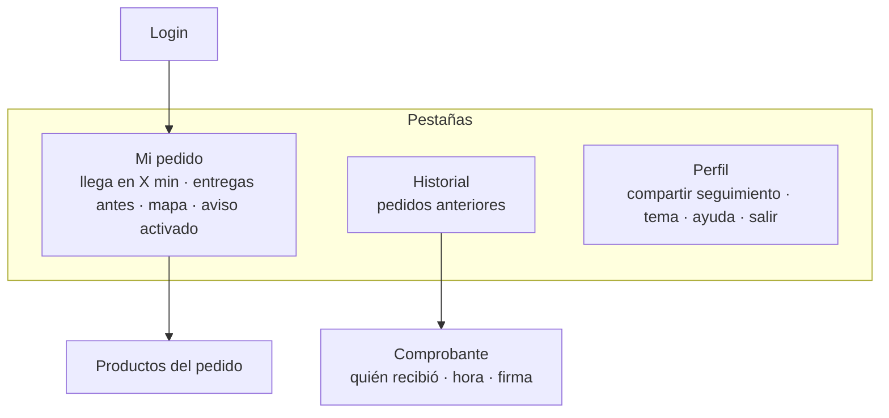

# Nuevo mapa de navegación

> Basado en la auditoría y en el card sorting **SIMULADO**: se revisa cuando lleguen las respuestas reales.

## Qué cambia y por qué
| Cambio | Por qué |
|---|---|
| **Chofer: Ruta · Resumen · Perfil se mantienen**, con texto en todas las pestañas | El card sorting agrupa igual (Ruta 76 %, Resumen 100 %, Perfil 100 %); la auditoría pide texto (hallazgo 3) |
| **«Próxima entrega» como tarjeta propia** arriba de la Ruta, con «Ir» y «Entregar» | Las tarjetas 1 y 6 se agrupan con la ruta, no con la parada; deja de parecer una alerta (hallazgo 5) |
| **Parada = todo lo que pasa en el comercio**, con «Entregar y firmar» fijo abajo | El card sorting junta entregar, avisar, llamar y pedido (72 %); acción principal siempre a la vista (hallazgo 1) |
| **Acciones de la parada en el orden del trabajo:** Cómo llegar → Avisar → Llamar | Hallazgo 2 |
| **Confirmar entrega en 3 pasos con progreso** | Hallazgo 9 |
| **No se pudo entregar: motivo + foto opcional** | Hallazgo 10 y entrevistas |
| **Comercio: Mi pedido · Historial · Perfil**, con el aviso activado por defecto | Mi pedido 92 %; hallazgo 11 |
| **Historial sólo con pedidos anteriores**, con un acceso al pedido en curso | Hallazgo 14 |

## Chofer

## Comercio

